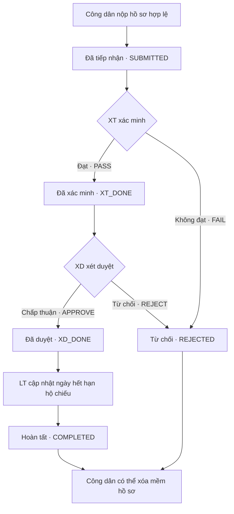

# Hệ thống gia hạn hộ chiếu

## Giới thiệu

Dự án môn học mô phỏng quy trình gia hạn hộ chiếu: công dân nộp hồ sơ, nhân viên xác minh và xét duyệt, sau đó cập nhật ngày hết hạn hộ chiếu. Đây là sản phẩm phục vụ học tập, chưa triển khai thực tế cho cơ quan nhà nước.

Dự án tập trung vào mô hình hóa quy trình nghiệp vụ, thiết kế cơ sở dữ liệu quan hệ, phân quyền theo vai trò và kết nối ứng dụng web với Oracle Database.

## Chức năng chính

Các chức năng dưới đây đã có trong mã nguồn; toàn bộ luồng chạy trên Oracle chưa được kiểm chứng trong lần rà soát tài liệu này.

- **Công dân:** đăng ký bằng CMND đã có trong dữ liệu cư dân, đăng nhập, nộp hồ sơ và theo dõi kết quả. Có thể ẩn hồ sơ đã hoàn tất hoặc bị từ chối bằng thao tác xóa mềm.
- **Nhân viên xác minh (XT):** xem hồ sơ theo đơn vị quận, đối chiếu với dữ liệu cư dân và hộ chiếu, ghi nhận đạt/không đạt cùng ghi chú.
- **Nhân viên xét duyệt (XD):** xem hồ sơ đã xác minh, chấp thuận hoặc từ chối.
- **Nhân viên hoàn tất hồ sơ (LT):** cập nhật ngày hết hạn hộ chiếu cho hồ sơ được chấp thuận.
- **Nhân viên giám sát (GS):** xem nhật ký xử lý và tìm theo mã hồ sơ.
- **Quản trị viên:** thêm, tra cứu dữ liệu cư dân và hộ chiếu.

Phần đăng ký/đăng nhập công dân còn thiếu quyền gọi procedure trong script Oracle; xem mục hướng dẫn chạy.

## Quy trình hoạt động

Cần có dữ liệu cư dân trước khi đăng ký; hộ chiếu tương ứng phải tồn tại trước khi nộp hồ sơ. Hồ sơ gửi lên phải dùng CMND đang đăng nhập và hộ chiếu đúng chủ sở hữu.

Sơ đồ thể hiện các nhánh xử lý được viết trong mã nguồn:



Xóa mềm giữ lại bản ghi và nhật ký, đồng thời ẩn hồ sơ khỏi danh sách của công dân. Bước hoàn tất cập nhật hộ chiếu hiện có; hệ thống không thực hiện cấp hoặc chuyển phát hộ chiếu.

## Công nghệ sử dụng

| Công nghệ | Mục đích |
| --- | --- |
| Python, FastAPI | Xử lý biểu mẫu, đăng nhập và các thao tác nghiệp vụ trên web. |
| Jinja2, Tailwind CSS | Hiển thị trang, biểu mẫu và danh sách hồ sơ; Tailwind được tải qua CDN. |
| Oracle Database, SQL, PL/SQL | Lưu dữ liệu, kiểm tra ràng buộc và xử lý trạng thái hồ sơ. |
| python-oracledb | Kết nối FastAPI với Oracle, thực thi SQL và gọi procedure. |
| Uvicorn, python-dotenv | Chạy ứng dụng và đọc cấu hình từ tệp `.env`. |

Luồng kết nối: **trình duyệt → FastAPI → Oracle Database**. FastAPI trả trang HTML; phần lớn quy tắc chuyển trạng thái nằm trong procedure và trigger của Oracle. Các thư viện được khai báo tại [requirements.txt](requirements.txt).

## Cơ sở dữ liệu và phân quyền

Dữ liệu chính gồm năm bảng:

- `RESIDENT_PROFILE`: thông tin cư dân và quận quản lý.
- `PASSPORT`: chủ sở hữu, ngày cấp và ngày hết hạn hộ chiếu.
- `ONLINE_ACCOUNT`: tài khoản công dân, liên kết với cư dân qua CMND.
- `PASSPORT_RENEWAL_APP`: hồ sơ gia hạn, kết quả xử lý và trạng thái.
- `PROCESS_LOG`: nhật ký các bước xử lý theo hồ sơ.

Tài khoản và hộ chiếu liên kết với cư dân; mỗi hồ sơ tham chiếu tài khoản nộp và hộ chiếu, đồng thời có các bản ghi nhật ký tương ứng. Khóa ngoại, ràng buộc dữ liệu và trigger hỗ trợ kiểm tra dữ liệu đầu vào.

Công dân truy cập qua tài khoản Oracle chung `ONLINE_APP`; nhân viên dùng tài khoản Oracle riêng theo vai trò. Script có các nhóm quyền xem dữ liệu và gọi procedure xử lý hồ sơ.

Ba cơ chế bảo mật được khai báo trong [FULL DATABASE.txt](FULL%20DATABASE.txt):

- **VPD:** lọc hồ sơ theo CMND, đơn vị xử lý, trạng thái và dấu xóa mềm.
- **OLS:** gắn nhãn dữ liệu theo quận và giai đoạn xử lý.
- **Database Vault:** cấu hình vùng bảo vệ cho các bảng và tài khoản được phép truy cập.

Đây là cấu hình trong mã nguồn, chưa phải bằng chứng kiểm thử phân quyền. Đặc biệt, quyền OLS `READ` đang được gán cho các tài khoản nghiệp vụ cho phép bỏ qua kiểm tra nhãn khi đọc; cần rà soát cùng với VPD và quyền truy cập bảng. Tham khảo [tài liệu quyền OLS của Oracle](https://docs.oracle.com/en/database/oracle/oracle-database/19/olsag/access-controls-and-privileges.html).

## Giao diện minh họa

Repository hiện chưa có ảnh chụp giao diện thực tế.

## Hướng dẫn chạy dự án

### 1. Chuẩn bị Oracle

Cần Python có `pip`, `venv` và một Oracle Database hỗ trợ, đã bật các tính năng bảo mật sử dụng trong script. Repository chưa xác định phiên bản Oracle đã kiểm thử hoặc cung cấp quy trình thiết lập Oracle hoàn chỉnh.

- Rà soát [FULL DATABASE.txt](FULL%20DATABASE.txt) với tài khoản quản trị phù hợp; thay mật khẩu ghi sẵn trước khi sử dụng. Script chưa được thiết kế để chạy lặp lại an toàn.
- Bổ sung quyền `EXECUTE` còn thiếu cho `PROC_CREATE_ACCOUNT` và `PROC_AUTH_USER` đối với `ONLINE_APP` hoặc nhóm quyền của tài khoản này.
- Kiểm tra các đối tượng, chính sách và quyền truy cập; chuẩn bị dữ liệu cư dân/hộ chiếu giả lập. Repository không kèm dữ liệu mẫu.

### 2. Cài thư viện và cấu hình

Chạy tại thư mục gốc của dự án bằng PowerShell:

```powershell
python -m venv .venv
.\.venv\Scripts\python.exe -m pip install -r requirements.txt
if (-not (Test-Path .env)) { Copy-Item .env.example .env }
```

Điền cấu hình thật vào `.env` theo [tệp mẫu](.env.example):

- `ORACLE_DSN`: chuỗi kết nối đến dịch vụ Oracle đã chuẩn bị.
- `ONLINE_APP_USER`: tài khoản kết nối cho công dân; script hiện sử dụng `ONLINE_APP`.
- `ONLINE_APP_PASS`: mật khẩu của tài khoản đó.
- `SESSION_SECRET`: khóa ký session riêng, đủ mạnh, thay giá trị mẫu và mặc định.

Không đưa `.env` hoặc thư mục `.venv` lên GitHub. Tệp `.env` đã được `.gitignore` loại trừ; thư mục `.venv` thì chưa.

### 3. Khởi động ứng dụng

```powershell
.\.venv\Scripts\python.exe -m uvicorn app.main:app --reload --host 127.0.0.1 --port 8000
```

Mở `http://127.0.0.1:8000/login`. Giao diện cần kết nối mạng để tải Tailwind CSS. Các lệnh trên chỉ chuẩn bị và khởi động ứng dụng, không thay thế bước cấu hình Oracle.

## Giới hạn của dự án

- **Chưa có bằng chứng kiểm thử đầy đủ:** repository không có bộ kiểm thử tự động hoặc báo cáo kiểm thử. Cần kiểm tra luồng thành công, hai nhánh từ chối và truy cập sai vai trò trước khi trình diễn.
- **Thông tin xác thực chưa an toàn:** mã nguồn còn mật khẩu Oracle ghi sẵn và khóa ký session mặc định. Mật khẩu Oracle của nhân viên được lưu trong cookie session có chữ ký nhưng không mã hóa. Cần xử lý trước khi chia sẻ môi trường chạy.
- **Đăng ký chưa xác minh chủ sở hữu CMND:** nhiều tài khoản có thể gắn với cùng CMND và truy cập cùng phạm vi hồ sơ.
- **Quyền truy cập còn rộng:** quản trị viên dùng tài khoản có quyền `DBA`; tài khoản ứng dụng được đọc nhật ký chứa thông tin cá nhân mà chưa có chính sách lọc riêng. Nhật ký nghiệp vụ chưa thay thế cơ chế kiểm toán cơ sở dữ liệu độc lập.
- **Bảo vệ đầu vào chưa đầy đủ:** điều kiện VPD ghép trực tiếp CMND vào SQL; biểu mẫu chưa có kiểm tra CSRF để ngăn yêu cầu giả mạo.
- **Một số kiểm tra nghiệp vụ còn thiếu:** thao tác XT/XD chưa kiểm tra số bản ghi thực sự cập nhật trước khi báo thành công; chưa bắt buộc ngày hết hạn mới lớn hơn ngày cũ hoặc ngăn hồ sơ đang chờ bị nộp trùng.

Dự án chưa hỗ trợ tải giấy tờ, thanh toán, thông báo hay quy trình khiếu nại. Phạm vi hiện tại tập trung vào xử lý hồ sơ và thực hành cơ sở dữ liệu, phân quyền.
