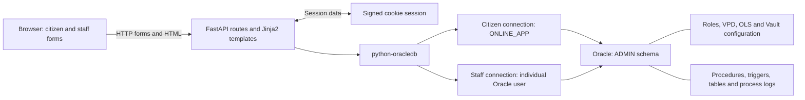
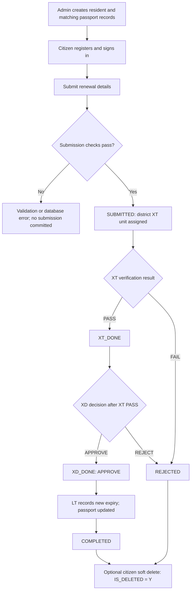
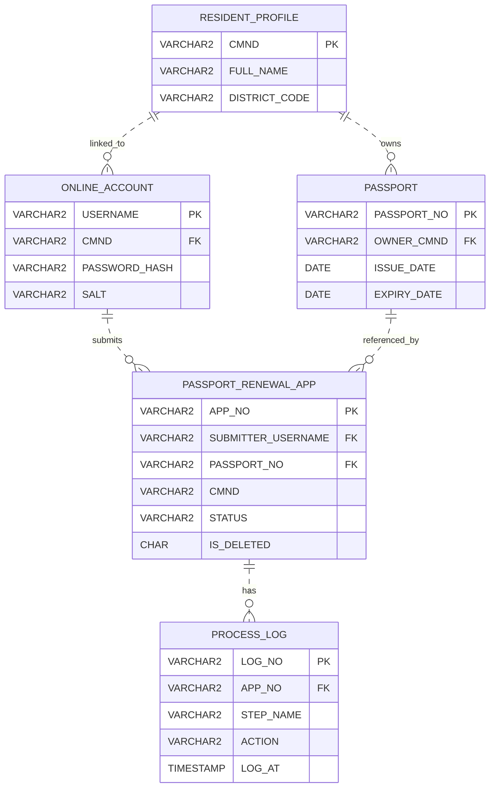

# Passport Renewal System — Oracle Database Security & FastAPI

## Project Overview

An academic web application that models passport renewal through citizen submission, district verification, approval, and passport expiry updates. The project explores how a business workflow can be represented through relational data, role-specific screens, PL/SQL procedures, triggers, and Oracle security policies.

FastAPI serves HTML pages and coordinates database calls; Oracle holds the business records and most workflow rules. The interface uses Vietnamese and English labels. This repository is a learning project, not a production service or an integration with a government passport system.

**Implementation status:** the features below are present in source code. The repository contains no automated tests, recorded test results, or deployment evidence. Oracle execution and end-to-end behavior have not been verified for this README, and the supplied database setup has gaps described below.

## Key Features

| Area | Functionality present in source | Implementation |
| --- | --- | --- |
| Citizen access | Register against an existing resident ID (`CMND`); authenticate through Oracle procedures. Required procedure grants are missing from the supplied script. | [Authentication routes](app/routes/auth.py) |
| Citizen applications | Submit personal and passport details; view status counts and renewal results; soft-delete completed or rejected applications. | [Citizen routes](app/routes/citizen.py) |
| Verification (XT) | View a district queue, compare submitted details with resident/passport records, highlight name/gender/address differences, and record `PASS` or `FAIL` with a note. | [XT routes](app/routes/staff_xt.py) |
| Approval (XD) | Review verified applications and record `APPROVE` or `REJECT` with a note. | [XD routes](app/routes/staff_xd.py) |
| Completion (LT) | Read reduced-column views and enter a new expiry date to update the existing passport and complete an approved application. | [LT routes](app/routes/staff_lt.py) |
| Monitoring (GS) | Search process logs by application number and display up to 300 recent entries. | [GS routes](app/routes/staff_gs.py) |
| Administration | Insert resident and passport records; search and list up to 200 rows per table. | [Admin routes](app/routes/admin.py) |

Registration does not create a resident record. Completion changes the expiry of an existing passport; physical issuance, document uploads, payments, and notifications are outside the implemented scope.

## Technology Stack

| Layer | Technology in the repository |
| --- | --- |
| Backend | Python; FastAPI `0.115.6`; Uvicorn with standard extras `0.32.1` |
| HTML rendering | Jinja2 `3.1.4`; Tailwind CSS loaded from a CDN; small inline JavaScript interactions |
| Forms and configuration | python-multipart `0.0.12`; python-dotenv `1.0.1` |
| Sessions | Starlette `SessionMiddleware` through FastAPI; itsdangerous `2.2.0` |
| Database client | python-oracledb `2.5.1`; direct SQL and PL/SQL calls, without an ORM |
| Database | Oracle SQL/PLSQL, VPD, Oracle Label Security, Database Vault realm configuration, and `DBMS_CRYPTO` |

Versions come from [requirements.txt](requirements.txt). Python, Oracle, Starlette, and the CDN stylesheet version are not explicitly pinned in the repository. No frontend build pipeline is included.

## System Architecture



- **Citizen requests:** the backend connects as `ONLINE_APP`. After login, application routes set `APP_CTX.CMND` through `ADMIN.PKG_APP_CTX.SET_CMND`; VPD uses that value to filter application records.
- **Staff requests:** login checks an Oracle username/password by opening a connection. Subsequent requests reconnect with credentials held in the session. The web role is derived from the username in [session.py](app/utils/session.py).
- **Database interaction:** [db.py](app/core/db.py) opens a connection for each operation; there is no connection pool. Routes use bind parameters and `callproc`, then commit or roll back writes and close the connection. Admin inserts use direct SQL.
- **Workflow ownership:** procedures perform writes, triggers assign status/timestamps/labels, and `PROC_WRITE_LOG` records business actions within the same transaction. Citizen and XT/XD/LT/GS routes also set a database client identifier.

Several queue queries deliberately omit application-level ownership filters and depend on the Oracle policies. Session storage and effective database permissions therefore require particular care; see [Known Limitations](#known-limitations).

## Business Workflow

The diagram follows the coded procedure/trigger paths for the designated users. It describes intended transitions, not a completed integration test.



1. **Submit:** FastAPI generates a UUID application number, checks that the submitted `CMND` matches the citizen session, and calls `PROC_SUBMIT_APP`. Triggers look up the resident's district, set `XT_UNIT`, and check passport ownership.
2. **Verify:** `PROC_XT_VERIFY` targets `SUBMITTED` records. For an XT database session, the status trigger records `XT_AT` and moves the application to `XT_DONE` or `REJECTED`. Highlighted differences support a human decision; they do not automatically reject an application.
3. **Decide:** `PROC_XD_DECIDE` targets `XT_DONE` records with `XT_RESULT = 'PASS'`. The XD trigger records `XD_AT` and sets `XD_DONE` for approval or `REJECTED` for rejection.
4. **Complete:** the LT route checks visibility through its view and an `APPROVE` decision. `PROC_LT_COMPLETE` updates `PASSPORT.EXPIRY_DATE` and `NEW_EXPIRY_DATE`; the LT trigger sets `COMPLETED`.
5. **Hide a terminal application:** `PROC_CITIZEN_SOFT_DELETE` permits only `COMPLETED` or `REJECTED`. It records deletion metadata without changing the status or physically removing the application/logs.

There is no implemented appeal, resubmission transition, or cancellation of a pending application. A citizen can submit a separate new application.

## User Roles and Permissions

These are the web capabilities and database scopes declared in the code. Effective enforcement still needs Oracle integration tests.

| Role | Database identity / role | Web entry | Declared scope |
| --- | --- | --- | --- |
| Citizen | Shared `ONLINE_APP` / `ROLE_USER` | `/citizen` | VPD selects applications matching `APP_CTX.CMND`, excluding soft-deleted rows. This is resident-level scope, not username-level scope. |
| XT verifier | `XT_Q1` through `XT_Q12` / `ROLE_XT` | `/staff/xt` | Application VPD requires matching `XT_UNIT`, `SUBMITTED`, and not deleted; also granted resident/passport reads and verification procedure execution. |
| XD approver | `XD_USER` / `ROLE_XD` | `/staff/xd` | Application VPD selects non-deleted `XT_DONE` rows; decision procedure additionally requires `PASS`. |
| LT completion officer | `LT_USER` / `ROLE_LT` | `/staff/lt` | Reads `VW_LT_RENEWAL_APP` and `VW_LT_PASSPORT`; application VPD selects non-deleted `XD_DONE` rows; completion requires approval. |
| GS monitor | `GS_USER` / `ROLE_GS` | `/staff/gs` | Reads process logs. A separate application-viewing procedure exists in SQL but has no corresponding web route. |
| Administrator | `ADMIN`, schema owner with `DBA`, `LBAC_DBA`, and realm-owner authorization | `/admin` | Web page inserts/searches resident and passport records. Database privileges are much broader than these screens. |

The LT views omit names, resident IDs, addresses, and contact fields, but still expose passport numbers; they are not anonymized datasets. The roles also grant broader direct database access than the screens show, particularly to passport records and process logs.

## Database Design

All application objects are defined in [FULL DATABASE.txt](FULL%20DATABASE.txt), principally under schema `ADMIN`.

| Table | Purpose and important fields |
| --- | --- |
| `RESIDENT_PROFILE` | Master resident data keyed by `CMND`, including name, gender, address, and district. |
| `PASSPORT` | Passport number, resident owner, issue date, and expiry date. |
| `ONLINE_ACCOUNT` | Username, resident ID, salted password hash, salt, hash algorithm, active flag, and creation timestamp. |
| `PASSPORT_RENEWAL_APP` | Submitted details, passport/account references, workflow status, XT/XD outcomes and timestamps, new expiry, and soft-delete metadata. |
| `PROCESS_LOG` | Application-linked action records with step, actor, timestamp, and note. Notes may include resident and passport details. |

The ERD shows declared foreign keys and selected columns:



`PASSPORT_RENEWAL_APP.CMND` has no direct resident foreign key; resident lookup and passport-owner checks are implemented in triggers. `ONLINE_ACCOUNT.CMND` is not unique, so multiple accounts can reference the same resident. There is no constraint tying the application's resident ID to the submitter account's resident ID; the normal web path supplies that association.

**Constraints:** primary and foreign keys enforce the relationships above. Check constraints enumerate gender, active/deleted flags, workflow statuses, XT results, XD decisions, and allowed log steps/actions. District membership and date ordering are not enforced with check constraints.

**PL/SQL responsibilities:**

| Objects | Responsibility |
| --- | --- |
| `FN_SHA256_HEX`, `PROC_CREATE_ACCOUNT`, `PROC_AUTH_USER` | Generate a random salt, hash credentials, and check the password and account active flag. |
| `PKG_APP_CTX`, `FN_VPD_RENEWAL_APP` | Set the citizen context and return user-specific application predicates. |
| `PROC_SUBMIT_APP`, `PROC_XT_VERIFY`, `PROC_XD_DECIDE`, `PROC_LT_COMPLETE`, `PROC_CITIZEN_SOFT_DELETE` | Execute workflow writes and call the process logger. |
| `PROC_WRITE_LOG`, `PROC_GS_VIEW_APP` | Write business logs; optionally log and return an application through a reference cursor. The GS web page only reads the log table. |
| `TRG_APP_ENFORCE_SUBMIT`, `TRG_APP_CHECK_PASSPORT_OWNER` | Assign district routing/status on submission and check passport ownership. |
| `TRG_APP_XT_STATUS`, `TRG_APP_XD_STATUS`, `TRG_APP_LT_STATUS` | Apply transitions for the relevant database session user. |
| `TRG_RESIDENT_SET_OLS`, `TRG_APP_SET_OLS_STAGE` | Assign resident district labels and relabel applications when workflow fields change. |

## Database Security

| Mechanism | Configuration present | Intended purpose and verification boundary |
| --- | --- | --- |
| VPD | Three `DBMS_RLS.ADD_POLICY` calls apply `FN_VPD_RENEWAL_APP` to application `SELECT`, `UPDATE`, and `DELETE`; no insert policy is declared. | Filters by database session user, citizen context, district, status, and deletion flag. `ADMIN` and `GS_USER` receive an unrestricted predicate; unknown users receive a deny-all predicate. Runtime behavior through views/procedures is unverified. |
| Oracle Label Security | `RES_POL`, `OLS_LABEL`, `PUBLIC`/`RESTRICTED` levels, XT/XD/LT/GS compartments, and district groups Q1–Q12 under ALL; `READ_CONTROL` applied to residents and applications. | Models district/stage labels. However, the script grants special OLS `READ` privileges to the application and business users and `FULL` to `ADMIN`; this is not strict label-based read isolation. |
| Database Vault | `RESIDENT_PASSPORT_APP_REALM`, five protected tables, participant authorizations, and `ADMIN` as realm owner. | Intended to control access to protected objects, including privileged access. Feature enablement, installation prerequisites, and actual realm enforcement are not demonstrated. |
| Roles and privileges | Five business roles; read/view grants and procedure execution grants; statements revoking direct workflow DML. | Separates screens and operations, but broad administrator privileges and missing authentication grants prevent a claim of a complete least-privilege configuration. |
| Logging and auditing | `PROCESS_LOG`, procedure-based log writes, and `DBMS_SESSION.SET_IDENTIFIER` calls. | Provides business-action logging in source. No Unified Audit policy, `AUDIT` configuration, or FGA policy is supplied; setting a client identifier does not enable database auditing. |

Oracle documents that the special OLS `READ` privilege bypasses label-based read checks, while object privileges still apply. Consequently, the declared application VPD predicates remain important, and resident district labels alone do not restrict XT reads under these grants. This conclusion comes from the script and [Oracle's privilege documentation](https://docs.oracle.com/en/database/oracle/oracle-database/19/olsag/access-controls-and-privileges.html), not a live access-control test.

Application labels change when XT/XD/expiry fields are updated, including rejection paths; labels do not themselves prove successful workflow progression. The script also grants access to `DBMS_REDACT` but defines no redaction policy.

## Project Structure

```text
.
|-- README.md
|-- FULL DATABASE.txt          # Schema, security configuration, and PL/SQL
|-- requirements.txt
|-- .env.example
|-- .gitignore
`-- app/
    |-- main.py                # FastAPI application, sessions, router registration
    |-- core/
    |   |-- config.py          # Environment-based configuration
    |   `-- db.py              # Oracle connection helper
    |-- routes/
    |   |-- __init__.py
    |   |-- auth.py
    |   |-- citizen.py
    |   |-- admin.py
    |   |-- staff_home.py
    |   |-- staff_xt.py
    |   |-- staff_xd.py
    |   |-- staff_lt.py
    |   `-- staff_gs.py
    |-- templates/             # 11 HTML templates for login, forms, and dashboards
    |-- utils/session.py       # Session checks, role mapping, and Oracle context
    `-- web/templates.py       # Jinja2 template directory configuration
```

## Installation and Setup

### Prerequisites and Oracle preparation

Use a local learning environment with Python, `pip`, `venv`, and a reachable Oracle database. The repository does not specify a tested Python/Oracle version or provide a database container, seed dataset, or complete provisioning guide.

The script labels section A **RUN AS SYS** and section B **RUN AS ADMIN**. These are source annotations, not sufficient setup instructions: the target database must support and enable the required Oracle features, and the executing accounts must have the appropriate OLS/Database Vault administration authorizations. The example DSN references `FREEPDB1`; that service name alone does not establish feature availability.

Before attempting the workflow:

- Review the database script for the target environment and replace its embedded demonstration passwords. It contains unconditional object creation and revocations of privileges not previously granted in this script, so it is not a repeatable migration.
- Resolve the missing `EXECUTE` grants for `PROC_CREATE_ACCOUNT` and `PROC_AUTH_USER` to the backend account or its role. The web routes call them as `ONLINE_APP`, but the supplied script does not authorize those calls.
- Verify object compilation, active policies, role grants, and procedure access using the intended accounts. No successful Oracle installation transcript is included.
- Provide synthetic resident and matching passport records before citizen registration/submission. The `/admin` page contains insert forms once the database is configured; no sample records are bundled.

### Python environment

From the repository root, using PowerShell:

```powershell
python -m venv .venv
.\.venv\Scripts\python.exe -m pip install -r requirements.txt
if (-not (Test-Path .env)) { Copy-Item .env.example .env }
```

Edit the local `.env` with actual values. [config.py](app/core/config.py) reads exactly these variables:

| Variable | Required value |
| --- | --- |
| `ORACLE_DSN` | Connection string for the prepared Oracle service. |
| `ONLINE_APP_USER` | The provisioned backend user; the supplied SQL expects `ONLINE_APP`. |
| `ONLINE_APP_PASS` | That user's actual database password. |
| `SESSION_SECRET` | A strong, private signing secret replacing the example placeholder and the code's development fallback. |

Keep `.env` private; it is ignored by Git. The current `.gitignore` does not exclude `.venv`, so keep the local environment out of commits as well. Do not reuse the script's demonstration credentials.

### Start the local web server

```powershell
.\.venv\Scripts\python.exe -m uvicorn app.main:app --reload --host 127.0.0.1 --port 8000
```

Open `http://127.0.0.1:8000/login`. Staff authentication uses provisioned Oracle accounts; citizen authentication uses `ONLINE_ACCOUNT`. These commands follow the dependency file and application entry point; they do not resolve the Oracle setup gaps. The Tailwind CDN requires network access for styling.

## Screenshots

No interface screenshots are included in this repository. Useful future captures are the citizen status dashboard, XT comparison screen, LT completion form, and GS log view, using synthetic data with credentials and personal information removed.

## Verification Status

| Evidence | Status |
| --- | --- |
| Routes, templates, schema, procedures, and policies | Inspected together to trace the features and workflow described here. |
| Python and template syntax | All 14 Python files parsed and all 11 Jinja templates compiled during documentation review; this does not exercise business behavior. |
| Documentation checks | All three diagrams parsed and rendered with Mermaid 10.9.3; local links and referenced SQL object names checked against the repository. |
| Automated tests, CI runs, manual test reports | None included in the repository. |
| Oracle provisioning, procedure execution, VPD/OLS/Vault enforcement | Not verified against a running database during this review. |
| Complete web workflow | Not executed; missing grants and other limitations remain unresolved. |

Before presenting a working demonstration, capture tests for the successful renewal path, both rejection paths, cross-resident/cross-district access, invalid passport ownership, unauthorized role actions, repeated decisions, and terminal-only soft deletion. These are proposed checks, not reported results.

## Known Limitations

1. **Staff credentials in a browser cookie.** [auth.py](app/routes/auth.py) stores `db_user` and `db_pass` in the session. Starlette sessions are signed, readable cookies, not encrypted storage, so the Oracle password is included in client-side session data. [main.py](app/main.py) does not enable `https_only`; [config.py](app/core/config.py) also supplies a fixed fallback signing secret. Replace credential-bearing cookies and the fallback before any shared deployment. See [Starlette session behavior](https://starlette.dev/middleware/#sessionmiddleware).
2. **Embedded credentials and excessive privilege.** The SQL file contains hardcoded demonstration passwords, and the web administrator authenticates as a schema owner granted `DBA`. Remove embedded credentials and rotate any reused values before publishing; separate application administration from database ownership. No secret values are reproduced here.
3. **Registration does not prove identity.** An existing `CMND` is sufficient to register, and multiple usernames may reference it. Because citizen VPD filters by `CMND`, another account linked to that resident can access the same application scope. Identity ownership checks are needed.
4. **Database access is broader than the UI.** OLS `READ` bypasses label read checks. XT has direct passport reads; `ROLE_USER` has `SELECT` on all process logs, which have no supplied VPD/OLS policy and may contain personal data. LT's passport view also has no row filter. These grants need review independently of web route checks.
5. **Procedure boundaries need validation.** Procedures use Oracle's default definer-rights model; several rely on VPD for ownership/district checks instead of checking those conditions explicitly. Submission does not itself verify account/context ownership, and the LT procedure lacks its own `XD_DONE` condition. Verify effective privileges and policy behavior before treating the procedures as authorization boundaries. See [Oracle's definer-rights documentation](https://docs.oracle.com/en/database/oracle/oracle-database/26/dbseg/definers-rights-and-invokers-rights.html).
6. **Workflow outcomes can be misleading.** XT and XD procedures do not check `SQL%ROWCOUNT` before logging, so a no-op update can still produce a log and success redirect for an existing application. No rule requires a new expiry to exceed the old expiry, no duplicate-pending-application rule is defined, and no concurrency test evidence is supplied.
7. **Input and web hardening are incomplete.** District validation only checks a `Q` prefix; the fallback OLS label `R:XT:ALL` is referenced but not explicitly created. The VPD predicate concatenates the resident ID without escaping it. No explicit CSRF-token checks or login rate limiting are present, and database error text is returned in pages or redirect parameters.
8. **Business logs are not comprehensive auditing.** Logging shares the business transaction and rolls back with it; general reads, failed operations, and admin inserts are not automatically recorded. Staff client identifiers refer to a `staff_username` session field that login never sets, and `ACTOR` is truncated to 50 characters. There is no independent audit-policy configuration or evidence of tamper-resistant logging.
9. **Password storage and reproducibility need improvement.** Citizen passwords use salted, single-pass SHA-256 rather than a password-specific adaptive hash. The missing authentication grants, unverified Oracle prerequisites, absent tests/screenshots, and incomplete setup documentation prevent a reproducible end-to-end demonstration from being claimed.

The project's portfolio value is its concrete mapping of business stages, relational constraints, role-specific interfaces, and database security concepts, together with a clear account of what still needs verification.
